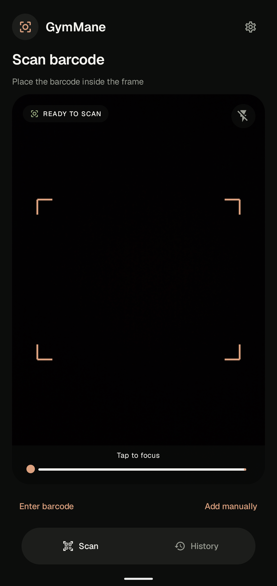

# 📷 GymMane-Scanner
Food barcode scanner app for GymMane. Scans product barcodes, retrieves nutritional data, and imports them directly into GymMane as new food entries.

---

**Scan a barcode. Get the nutrition facts. Send them straight to your calorie tracker.**

GymMane Scanner is a tiny Android app that turns the barcode on any food package into a ready-to-use food entry. No typing, no searching, no copying numbers by hand.

> **Heads up:** This is an independent, self-developed project. It is **not affiliated with, endorsed by, or connected to [GymMane](https://github.com/InlitX/GymMane)** in any way. It simply produces food data in a format GymMane can read.

---

## ✨ Why you'll like it

- 🔒 **Fully offline-friendly and private**: no account, no sign-up, no tracking: it only uses Internet connection for checking for updates and searching up the barcode in the open food facts database anonymously
- 🚫 **No trackers, no ads**
- ⚡ **Fast**: scan, check, send
- 🪶 **Simple**: it does one thing and does it well

---

## 📸 Screenshots

| Scan | Product | Send |
|:---:|:---:|:---:|
|  |  |  |

---

## 🚀 How it works

1. **Scan** the barcode on your food.
2. **Create the food**: the app builds a complete entry with all nutrition values.
3. **Send it to GymMane**. How depends on your GymMane version:

### GymMane 2.3.

1. In GymMane Scanner, tap **Copy**.
2. Open GymMane and tap create a food **Ask AI**.
3. **Paste** the copied code. Done.

### GymMane 2.4 and newer ✨

1. In GymMane Scanner, tap **Open in GymMane**.
2. That's it. GymMane opens with the food already filled in, ready to save.

---

## 📲 Installation

1. Go to the [**Releases**](../../releases) page and download the latest `.apk` file.
2. Open the file on your Android phone.
3. If asked, allow installing apps from this source.
4. Open the app and start scanning.

---

## ℹ️ Good to know

- Android only.
- Nutrition data depends on what is available for each product. If something looks off, double-check it against the package before saving.
- This is a hobby project, built for my own needs and shared in case it helps someone else.

---

## 💬 Feedback

Found a bug or have an idea? Open an [issue](../../issues). I'm happy to hear from you.
