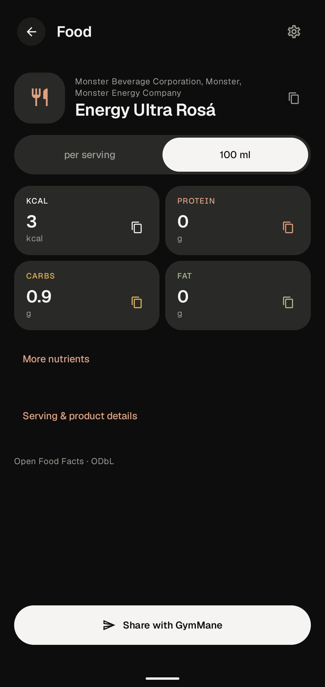
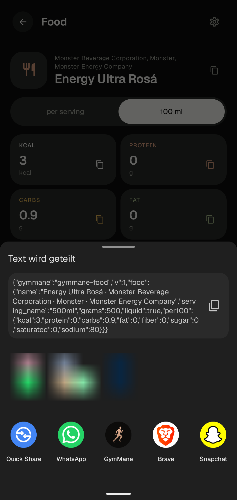

# GymMane Scanner

Native Android-App auf Deutsch und Englisch: Barcodes scannen, Nährwerte prüfen und Lebensmittel über den Android-Teilen-Dialog an GymMane übergeben. Mit lokalem Verlauf, manueller Erfassung und GitHub-Updateprüfung.

Dies ist ein unabhängiges Projekt ohne offizielle Verbindung zu GymMane.

## Installation und Screenshots

Die aktuelle APK steht unter [Releases](../../releases) zum Download bereit. Zur Installation auf dem Android-Gerät gegebenenfalls Installationen aus dieser Quelle erlauben. Für die Übergabe der Lebensmittel GymMane installieren.

| Scan | Produkt | Teilen |
| --- | --- | --- |
|  |  |  |

## Projektstand

- Version: **1.3.3**, `versionCode`: **7**
- Android 8.0 (API 26) oder neuer
- Kotlin, Jetpack Compose, CameraX und ML Kit
- Produktdaten von Open Food Facts
- Versionshinweise: [1.3.3](docs/RELEASE_v1.3.3.md), [1.3.2](docs/RELEASE_v1.3.2.md)

## Lokal bauen

Voraussetzungen: JDK 17 oder 21, Android SDK Platform 36 und die von Gradle angeforderten Android-Build-Tools. Android Studio kann die SDK-Komponenten installieren. Der Gradle-Wrapper liegt im Projekt; eine separate Gradle-Installation ist nicht nötig. Beim ersten Build ist Internetzugriff für die Abhängigkeiten erforderlich.

1. Projekt in Android Studio öffnen und Gradle synchronisieren. Alternativ `ANDROID_HOME` auf das lokale Android SDK setzen oder eine lokale `local.properties` mit `sdk.dir` anlegen. Diese Datei wird von Git ausgeschlossen.
2. Unter Windows eine Debug-APK bauen und die lokalen Prüfungen ausführen:

   ```powershell
   .\gradlew.bat :app:assembleDebug :app:testDebugUnitTest :app:lintDebug
   ```

   Unter Linux/macOS entsprechend `sh ./gradlew :app:assembleDebug :app:testDebugUnitTest :app:lintDebug` verwenden.

3. Die Debug-APK liegt unter `app/build/outputs/apk/debug/app-debug.apk`.

Debug-Builds benötigen keine privaten Release-Schlüssel. Gerätetests unter `app/src/androidTest` lassen sich mit `:app:connectedDebugAndroidTest` auf einem angeschlossenen Android-Gerät oder Emulator ausführen.

## Release bauen

Die Datei `keystore.properties.example` nach `keystore.properties` kopieren und ausschließlich lokal mit dem eigenen Keystore-Pfad, Alias und den Passwörtern befüllen. Den Keystore möglichst außerhalb des Projektordners aufbewahren und separat sichern.

```powershell
.\gradlew.bat :app:testReleaseUnitTest :app:lintRelease :app:assembleRelease
```

Die signierte APK liegt unter `app/build/outputs/apk/release/app-release.apk`. Die zugehörige `app/build/outputs/mapping/release/mapping.txt` für die Fehleranalyse privat aufbewahren. Für Updates derselben App immer denselben Signierschlüssel verwenden; Debug- und Release-Builds haben unterschiedliche Signaturen.

APK-Dateien und lokale Archive unter `artifacts/` werden von Git ausgeschlossen. Die Veröffentlichungsvorbereitung ist in [docs/PUBLISHING.md](docs/PUBLISHING.md) beschrieben.

## In-App-Updates

Die Updatequelle steht in `app/src/main/java/de/gymmane/scanner/updates/Release.kt` als `UpdateConfig.REPOSITORY`. Der in den Einstellungen angezeigte Quellcode-Link steht in `gradle.properties` als `scanner.repositoryUrl`. Beide verweisen derzeit auf `KingMezzo/GymMane-Scanner`; bei einem Fork beide Angaben anpassen. Diese öffentlichen Adressen richten keine Git-Verbindung ein.

Die App fragt bei aktivierter Automatik beim Öffnen höchstens alle 24 Stunden den öffentlichen GitHub-Endpunkt für den neuesten Release ab. Die manuelle Prüfung liegt in den Einstellungen. Nur neuere normale Releases mit passender APK werden angeboten. Der Download-Link stammt aus den Release-Metadaten; ein fester APK-Dateiname ist nicht hinterlegt.

Vor dem Android-Installer prüft die App Größe, gegebenenfalls SHA-256, Paketname, Version, höheren `versionCode` und Signatur. Nach einem Update erscheinen einmalig die Versionshinweise. Details stehen in [docs/UPDATES.md](docs/UPDATES.md).

## Quellcode und Daten

Quellcode, Ressourcen und Tests liegen unter `app/src`. Gradle-Wrapper und Build-Konfiguration gehören zum öffentlichen Projekt. Lokale Schlüssel, Einstellungen, Build-Ausgaben, Speicherabbilder und Release-Archive sind über `.gitignore` ausgeschlossen.

Kamerabilder werden nicht hochgeladen. Gescannte Barcodes werden für Produktabfragen an Open Food Facts übermittelt. Verlauf und manuelle Einträge bleiben lokal; die Übergabe an andere Apps erfolgt über den Teilen-Dialog. Der Updater verwendet öffentliche GitHub-Anfragen ohne Zugangsdaten.

Produktdaten: Open Food Facts, ODbL; Produktbilder: CC BY-SA. Fehlende Nährwerte bleiben unbekannt. Diese Angaben betreffen die externen Daten und Bilder. Für den eigenen Quellcode ist noch keine Lizenz festgelegt.
